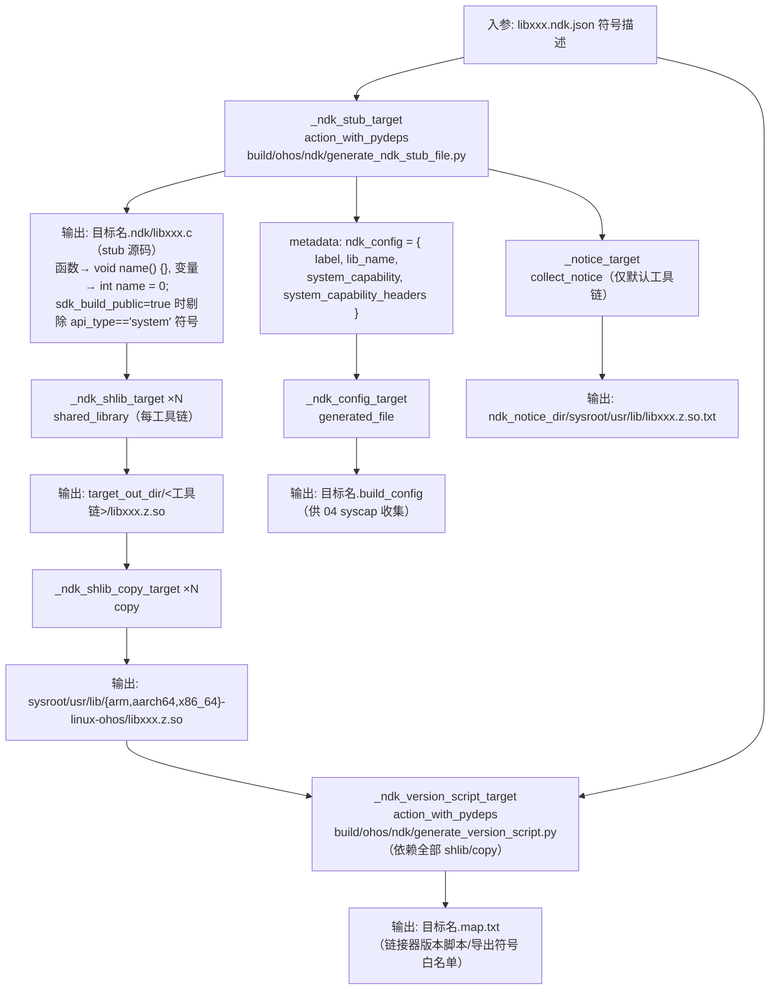
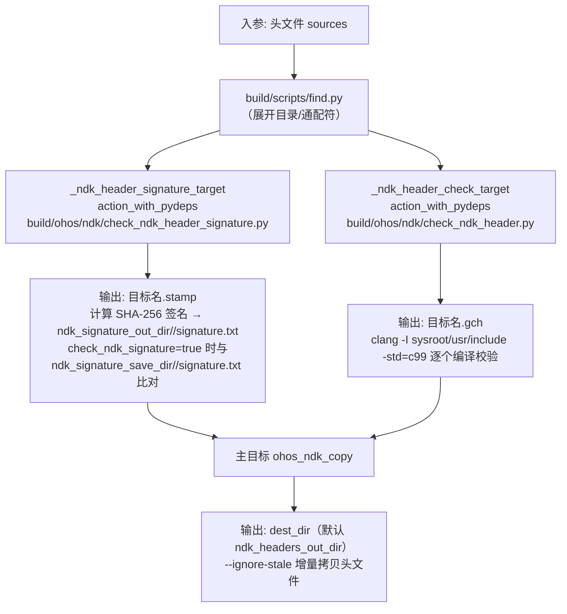

# 02 子系统 BUILD 与 NDK 模板（`build/ohos/ndk/ndk.gni`）

> 对应 [00-总览](./00-overview.md)「环节 02」，ninja 期真正干活的一环。
> 各子系统目录（`global/i18n`、`security/huks` 等）的 `BUILD.gn` 使用
> `build/ohos/ndk/ndk.gni` 中的 `ohos_*` 模板产出 NDK 库与头文件。

## 1. 环节职责

| 项 | 内容 |
| -- | ---- |
| 作用 | 把 `ndk_targets.gni` 注册的每个目标落实为：头文件拷贝到 sysroot、库由 stub 编译产出 |
| 模板定义 | `build/ohos/ndk/ndk.gni`（859 行） |
| 实际实例 | 各子系统 `BUILD.gn`（如 `global/i18n/BUILD.gn`、`security/huks/BUILD.gn`） |
| 产物 | `out/<产品>/sdk-native/os-irrelevant/sysroot/usr/{include,lib}` |

## 2. 模板逐个说明

<a id="ohos_ndk_library"></a>
### 2.1 `ohos_ndk_library`（库生成，ndk.gni:98-300）

由 `.ndk.json` 符号描述生成 stub 库：



| 子目标 | 脚本 | 作用 |
| ------ | ---- | ---- |
| `_ndk_stub_target` | `build/ohos/ndk/generate_ndk_stub_file.py` | 读 `.ndk.json`：函数生成 `void name() {}`、变量生成 `int name = 0;`；`sdk_build_public=true` 时剔除 `api_type=="system"` 符号；同时挂 `metadata = { ndk_config = [...] }` |
| `_ndk_config_target` | `generated_file` | 收集 `ndk_config` → `<target>.build_config`（供 syscap 收集） |
| `_ndk_shlib_target` ×N | `shared_library` | 每工具链编译 stub，输出 `target_out_dir/<工具链>/lib<name>.<ext>` |
| `_ndk_shlib_copy_target` ×N | `copy` | 拷贝到 `sysroot/usr/lib/{arm,aarch64,x86_64}-linux-ohos/` |
| `_notice_target` | `collect_notice` | 收集库 NOTICE → `$ndk_notice_dir/sysroot/usr/lib/lib<name>.<ext>.txt` |
| `_ndk_version_script_target` | `build/ohos/ndk/generate_version_script.py` | 生成 `.map.txt`（链接器版本脚本，导出符号白名单） |

**工具链**（ndk.gni:184-200）：

| 条件 | 工具链 |
| ----- | ------ |
| `build_ohos_ndk` 或 `use_current_sdk`，且主机为 linux/arm64 | `ohos_clang_arm64` |
| `build_ohos_ndk` 或 `use_current_sdk`，其余主机 | `ohos_clang_arm` / `ohos_clang_arm64` / `ohos_clang_x86_64` |
| 否则（`!is_arkui_x`） | `ohos_clang_${target_cpu}`（单工具链，不交叉编译） |

**关键参数**（见 `global/i18n/BUILD.gn:16-26` 实例）：

| 参数 | 含义 |
| ---- | ---- |
| `ndk_description_file` | `libxxx.ndk.json` 符号描述文件 |
| `min_compact_version` | 最低兼容版本（默认取 `sdk_version` 主版本） |
| `output_name` | 输出库名（默认目标名） |
| `output_extension` | `z.so`（默认）或 `so` |
| `system_capability` | 库对应的系统能力，写入 `.build_config` |
| `system_capability_headers` | 该 syscap 覆盖的头文件列表 |

<a id="ohos_ndk_headers"></a>
### 2.2 `ohos_ndk_headers`（头文件拷贝 + 检查，ndk.gni:418-532）



| 子目标 | 脚本 | 作用 |
| ------ | ---- | ---- |
| `_ndk_header_signature_target` | `build/ohos/ndk/check_ndk_header_signature.py` | 计算头文件 SHA-256 签名；`check_ndk_signature=true` 时与 `interface/sdk-native/<target>/signature.txt` 比对 |
| `_ndk_header_check_target` | `build/ohos/ndk/check_ndk_header.py` | `clang -I sysroot/usr/include -std=c99` 逐个编译校验（`ndk_check_header` 开启时执行，`libuv_uv_header` 除外） |
| 主目标 | `ohos_ndk_copy`（`build/ohos/ndk/ndk.gni:309-406`） | 拷贝到 `dest_dir`（默认 `$ndk_headers_out_dir`），`--ignore-stale` |

**实例**（`security/huks/BUILD.gn:43-51`）：
```gn
ohos_ndk_headers("huks_header") {
  dest_dir = "$ndk_headers_out_dir/huks"
  sources = [ "./include/native_huks_api.h", ... ]
}
```

### 2.3 其余拷贝类模板

| 模板 | 用途 | 落点 |
| ---- | ---- | ---- |
| `ohos_ndk_copy`（ndk.gni:309-406） | 通用拷贝（`copy_ex` + `--clear --follow-outside-symlinks`）+ 收集 notice | cmake 配置、compatible_config 等 |
| `ohos_ndk_toolchains`（540-544） | 拷贝 LLVM 交叉工具链目录 | `sdk-native/os-specific/<os>/llvm` |
| `ohos_ndk_prebuilt_library`（552-578） | 预置库拷贝（**预留模板，当前全仓无 BUILD.gn 调用实例，无使用场景**） | `sysroot/usr/lib/<arch>/-linux-ohos/` |
| `ohos_ndk_lite_library`（659-859） | lite（cortex-m / riscv32）库：`ohos_clang_riscv32` / `ohos_clang_cortex_m` 工具链，额外生成 `__stack_chk_fail` stub | `sysroot_lite/usr/lib/{riscv32-linux-ohos,arm-liteos-ohos}` |

## 3. 头文件前置来源（musl sysroot）

- `interface/sdk_c/third_party/musl/ndk_script/BUILD.gn` 的 `copy_musl_sysroot`（280-288 行）
  把 musl libc 头文件（含 arch bits/uapi）拷贝到 `$ndk_headers_out_dir`；
- `updated_version`（271-278 行）用 `api_version` 生成 `info/application_target_sdk_version.h`
  —— [03-头文件加工](./03-header-processing-00-overview.md) 的版本宏注入会 `#include` 这个头。

## 4. 关键细节

- 库是 **stub 库**（无真实实现，仅导出符号表），运行时实现由系统库提供；
- `z.so` 后缀库与 `.map.txt` 版本脚本配套，控制导出符号白名单；
- 每个库目标生成一份 `.build_config`，是 [04-syscap](./04-syscap-and-ani-cleanup.md) 收集 syscap 的输入。

## 5. 相关文件

| 文件 | 作用 |
| ---- | ---- |
| `build/ohos/ndk/ndk.gni` | 全部 NDK 模板定义 |
| `interface/sdk_c/global/i18n/BUILD.gn` | `ohos_ndk_library` + `ohos_ndk_headers` 实例 |
| `interface/sdk_c/security/huks/BUILD.gn` | 多库 + 多 headera 实例 |
| `interface/sdk_c/third_party/musl/ndk_script/BUILD.gn` | musl sysroot / libc / 工具链目标 |
| `build/ohos/ndk/generate_ndk_stub_file.py` | stub 生成 |
| `build/ohos/ndk/generate_version_script.py` | `.map.txt` 生成 |
| `build/ohos/ndk/check_ndk_header_signature.py` / `check_ndk_header.py` | 头文件签名 / 编译检查 |
