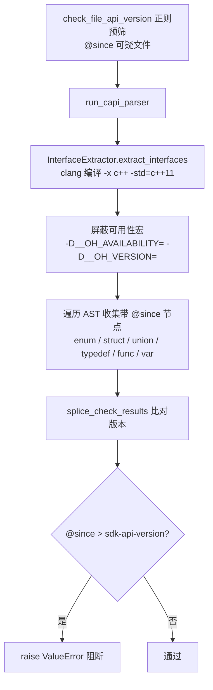

# 03.2 API 版本校验（`parse_interfaces_since.py`）

> 对应 [03-头文件加工](./03-header-processing-00-overview.md) 的 Step 2。
> 触发条件：`sdk_build_check_level != "0"`。
> 脚本：`interface/sdk_c/build-tools/parse_interfaces_since.py`（572 行），基于 **libclang**。

## 1. 环节职责

| 项 | 内容 |
| -- | ---- |
| 作用 | 校验头文件中 `@since` 标注的引入版本不高于当前构建的 API 版本 |
| 工具 | `libclang`（`clang.cindex`），定位 `prebuilts/clang/ohos/linux-x86_64/llvm/lib/libclang.so` |
| 违规处理 | `@since` 高于 `--sdk-api-version` → `raise ValueError` 阻断构建 |
| 额外 | 校验 `@since N` + `#define` 宏类接口、移除 `#pragma pack(N)` |

## 2. 处理流程



## 3. 关键机制

### 3.1 `InterfaceExtractor` 类（parse_interfaces_since.py:26-270）

- 编译参数：`-x c++ -std=c++11`，`-D__OH_AVAILABILITY(x)=`、`-D__OH_VERSION(a,b)=` 屏蔽可用性宏；
- 收集带 `@since` 的节点：

| 声明类型 | 处理方法 |
| -------- | -------- |
| `ENUM_DECL` / `STRUCT_DECL` / `UNION_DECL` | `_process_composite_decl`（151-179 行） |
| `TYPEDEF_DECL` | 197-208 行（含 elaborated typedef 与函数指针） |
| `FUNCTION_DECL` / `VAR_DECL` | `_process_other_declarations`（260-270 行） |

### 3.2 版本校验

- `splice_check_results`（337-384 行）：校验 `@since` 版本 **不得高于** `--sdk-api-version`，
  违规 `raise ValueError`（566-568 行）；
- 宏类接口：`find_since_define_pattern_with_line_numbers`（387-427 行）+
  `check_files_for_pattern`（463-488 行）识别 `@since N` + `#define` 模式；
- `replace_pragma_pack`（430-460 行）：移除 `#pragma pack(N)` 避免 clang 解析干扰。

## 4. 触发链路

```
parse_native_headers.py:main（Step 2）
  └─ check_api_version_method（490-509 行）
       └─ check_file_api_version（277-289 行，正则找 @since 违规文件）
            └─ run_capi_parser（370-416 行）
                 └─ parse_interfaces_since.py（libclang 深度校验）
```

## 5. 相关文件

| 文件 | 作用 |
| ---- | ---- |
| `interface/sdk_c/build-tools/parse_interfaces_since.py` | 本环节主脚本 |
| `interface/sdk_c/build-tools/parse_native_headers.py` | 调用方（Step 2） |
| `prebuilts/clang/ohos/linux-x86_64/llvm/lib/libclang.so` | libclang 依赖 |
