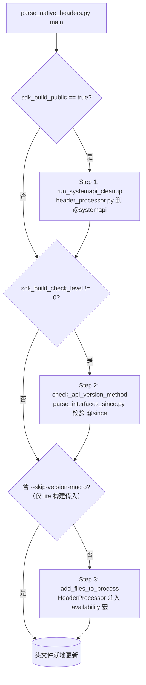

# 03 头文件加工（`_parse_ndk_headers` / `_parse_lite_ndk_headers` / `parse_native_headers.py`）

> 对应 [00-总览](./00-总览.md)「环节 03」。
> action：`build/ohos/ndk/BUILD.gn:82-96` `_parse_ndk_headers`、98-113 `_parse_lite_ndk_headers`。
> 主脚本：`interface/sdk_c/build-tools/parse_native_headers.py`（546 行）。
> 依赖：`all_ndk_targets_list`（非 lite）/ `all_lite_ndk_targets_list`（lite，先拷贝齐所有头文件），**就地修改** `sysroot/usr/include` / `sysroot_lite`。
> 两个 action 调用同一脚本、无相互依赖、ninja 中**并行执行**，仅 lite 分支追加 `--skip-version-macro`（见 [1.1](#11-两个并行-action-对比)）。

## 1. 环节职责

| 项 | 内容 |
| -- | ---- |
| 作用 | 对已拷贝到 sysroot 的头文件做三步加工：裁剪系统 API、校验 API 版本、注入版本可用性宏 |
| 输入 | `out/<产品>/sdk-native/os-irrelevant/sysroot/usr/include`（非 lite）、`sysroot_lite/usr/include`（lite） |
| 输出 | 同一目录原地改写 + `parse_ndk_headers.tmp` / `parse_lite_ndk_headers.tmp`（stamp） |
| 触发条件 | 各步骤按构建参数决定 |

### 1.1 两个并行 action 对比

| 项 | `_parse_ndk_headers`（非 lite） | `_parse_lite_ndk_headers`（lite） |
| -- | ---- | ---- |
| BUILD.gn 行号 | 82-96 | 98-113 |
| deps | `all_ndk_targets_list` | `all_lite_ndk_targets_list` |
| `--input` | `$ndk_headers_out_dir` | `$ndk_lite_headers_out_dir` |
| `--skip-version-macro` | 无（执行 Step 3 注入版本宏） | 有（跳过 Step 3） |
| 其余参数 | `--sdk-api-version` / `--sdk-build-public` / `--sdk-build-check-level` 相同，Step 1 / Step 2 同样执行 | 同左 |
| 输出 stamp | `parse_ndk_headers.tmp` | `parse_lite_ndk_headers.tmp` |

执行逻辑完全一致：Step 1 裁剪 `@systemapi`（`sdk_build_public=true` 时）、Step 2 校验 `@since`（`sdk_build_check_level != 0` 时），仅 Step 3 版本宏注入被 lite 分支用 `--skip-version-macro` 跳过。后续分别由 [04](./04-syscap与ANI清理.md) 的 `_collect_ndk_syscap` / `_collect_lite_ndk_syscap` 承接。

## 2. 处理流程



## 3. 三个步骤

### 3.1 Step 1：裁剪 `@systemapi`（`--sdk-build-public=true`）

`run_systemapi_cleanup(input_dir)`（parse_native_headers.py:434-467）调用同目录
`header_processor.py`：

- 输入 `-i <include>`、输出 `-o <临时目录>`；
- 删除带 `@systemapi` 标签的 API 声明；
- 成功后 `_copy_processed_back`（418-431 行）覆盖回原目录。

> `@systemapi` 是内部系统 API，公共 SDK 不对外暴露，构建 public SDK 时整段删除。
> 详见 [03.1 删除系统 API](./03-头文件加工-01删除系统API.md)。

### 3.2 Step 2：校验 `@since` 版本（`--sdk-build-check-level != 0`）

`check_api_version_method(args)`（490-509 行）：

1. `check_file_api_version`（277-289 行）正则扫描 `@since`，找出可疑违规文件；
2. 有违规文件时 `run_capi_parser`（370-416 行）调用 `parse_interfaces_since.py`，
   用 **libclang AST** 深度校验 `@since` 版本不得高于 `--sdk-api-version`；
3. 违规 `raise ValueError` 阻断构建。

> `--sdk-build-check-level` 默认为 `"0"`（不校验）。详见 [03.2 API 版本校验](./03-头文件加工-02API版本校验.md)。

### 3.3 Step 3：注入版本可用性宏（非 `--skip-version-macro`）

`add_files_to_process`（470-488 行）递归遍历头文件，交给 `HeaderProcessor.process_file`：

| 处理 | 方法 | 结果 |
| ---- | ---- | ---- |
| 识别 `@since` | `since_pattern`（75-81 行，支持 `26` / `26.0.1` / `5.0.3(15)`） | 定位声明版本 |
| 注入宏 | `_process_since_comment_related_code`（121-153 行） | 为紧邻的声明加 `__attribute__((__availability__(ohos, introduced=...)))` |
| 生成版本宏 | `_get_version_macro`（203-232 行） | 生成 `__attribute__((__availability__(ohos, introduced=...)))` 属性 |
| 插入 include | `_add_version_include`（180-200 行） | 在头文件保护宏后插入 `#include "info/application_target_sdk_version.h"` |
| 格式排版 | `_format_declaration`（235-248 行） | 按 120 列决定单行/换行 |

`--skip-version-macro` 仅 lite 构建（`_parse_lite_ndk_headers`）使用，跳过本步。

> 详见 [03.3 注入 API 版本可用性宏](./03-头文件加工-03API版本宏注入.md)。

## 4. 跳过目录

`HeaderProcessor._DIR_NOT_PROCESS`（parse_native_headers.py:27-41）黑名单，不处理：

```
aarch64-linux-ohos / arm-linux-ohos / asm-generic / asm-loongarch / asm-mips /
asm-riscv / EGL / GLES2 / GLES3 / i686-linux-ohos / linux / x86_64-linux-ohos / TEEKit
```

这些一般是系统头或三方头文件，不注入版本宏。

## 5. 关键参数（action args）

| 参数 | BUILD.gn 取值 | 含义 |
| ---- | ------------- | ---- |
| `--input` | `$ndk_headers_out_dir`（非 lite）/ `$ndk_lite_headers_out_dir`（lite） | 就地处理的头文件目录 |
| `--sdk-api-version` | `${platform_version}` | 当前构建 API 版本（版本校验上限） |
| `--sdk-build-public` | `${sdk_build_public}` | 是否 public 构建（`"true"` 触发 Step 1） |
| `--sdk-build-check-level` | `${sdk_build_check_level}` | 非 0 触发 Step 2 |
| `--skip-version-macro` | （仅 `_parse_lite_ndk_headers` 传入） | 跳过 Step 3 |

## 6. 相关文件

| 文件 | 作用 |
| ---- | ---- |
| `interface/sdk_c/build-tools/parse_native_headers.py` | 主流程（本环节） |
| `interface/sdk_c/build-tools/header_processor.py` | Step 1 `@systemapi` 裁剪 |
| `interface/sdk_c/build-tools/parse_interfaces_since.py` | Step 2 `@since` 校验 |
| `interface/sdk_c/build-tools/parse_native_headers.pydeps` | Python 依赖清单（生成文件，勿手改） |
| `build/ohos/ndk/BUILD.gn` | `_parse_ndk_headers` / `_parse_lite_ndk_headers` action |
