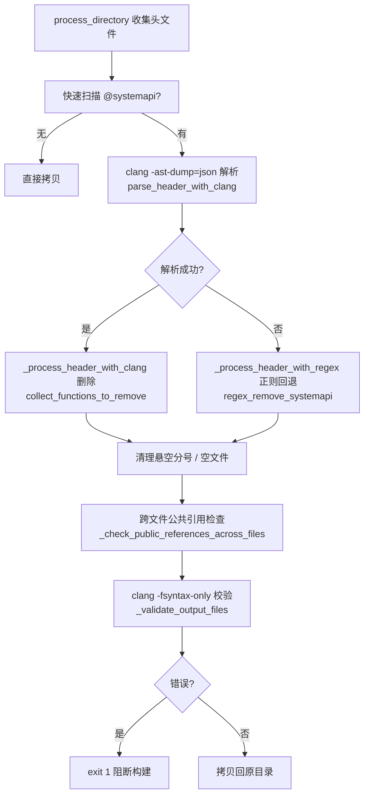

# 03.1 删除系统 API（`header_processor.py`）

> 对应 [03-头文件加工](./03-头文件加工-00总览.md) 的 Step 1。
> 触发条件：`sdk_build_public == "true"`（public SDK 构建时裁剪 `@systemapi`）。
> 脚本：`interface/sdk_c/build-tools/header_processor.py`（1887 行）。

## 1. 环节职责

| 项 | 内容 |
| -- | ---- |
| 作用 | 从 NDK 头文件中删除带 `@systemapi` 标签的 API 声明（函数 / 类型 / 宏 / 变量） |
| 输入 | `--input`（sysroot include 目录） |
| 输出 | `--output`（临时目录），成功后覆盖回原目录 |
| 阻断条件 | `public_ref_errors` / `validation_errors` 非空 → `sys.exit(1)` |

## 2. 处理流程

## 3. 关键机制

### 3.1 `SystemApiRemover` 类（header_processor.py:30）

- `SYSTEMAPI_NODE_KINDS`（38 行）：
  `FunctionDecl` / `TypedefDecl` / `EnumDecl` / `RecordDecl` / `CXXRecordDecl` / `VarDecl`；
- 标签识别：`has_systemapi_tag`（1275-1282 行）/ `_has_strict_systemapi`（1266-1273 行），
  剥离 `/* * !` 后严格等于 `@systemapi`。

### 3.2 clang 路径（主路径）

- `parse_header_with_clang`（1293-1327 行）：`clang -ast-dump=json` 解析，30s 超时；
  缺失头文件用 fake header 补齐（332-338 / 1021-1034 行）；
- `collect_functions_to_remove`（1105-1126 行）：收集待删除声明范围；
- `_process_header_with_clang`（808-868 行）：执行删除；
- `remove_macro_systemapi`（1513-1537 行）：补充删除相关宏。

### 3.3 regex 回退路径

- `_process_header_with_regex`（871-904 行）+ `regex_remove_systemapi`（1427-1460 行）：
  clang 失败时按文本正则删除 `@systemapi` 声明。

### 3.4 删除后清理与校验

| 步骤 | 方法 | 作用 |
| ---- | ---- | ---- |
| 清理悬空分号 | `_cleanup_orphan_semicolons`（1149-1157 行） | 删除后的 `;` 残留 |
| 删除空文件 | `_remove_empty_output_files`（1743-1773 行） | 输出为空则移除 |
| 公共引用检查 | `_check_public_references_across_files`（716-756 行） | 公共 API 引用了被删类型 → 记 `public_ref_errors` |
| 语法校验 | `_validate_output_files`（1789-1811 行） | `clang -fsyntax-only` 校验修改过的文件 |

## 4. 参数

| 参数 | 含义 |
| ---- | ---- |
| `-i / --input` | 输入头文件目录 |
| `-o / --output` | 输出目录（临时） |
| `--napi-dir` | napi 相关目录 |
| `--force-regex` | 强制走正则回退路径 |
| `--extensions` | 处理的文件后缀 |

## 5. 相关文件

| 文件 | 作用 |
| ---- | ---- |
| `interface/sdk_c/build-tools/header_processor.py` | 本环节主脚本 |
| `interface/sdk_c/build-tools/parse_native_headers.py` | 调用方（Step 1） |
