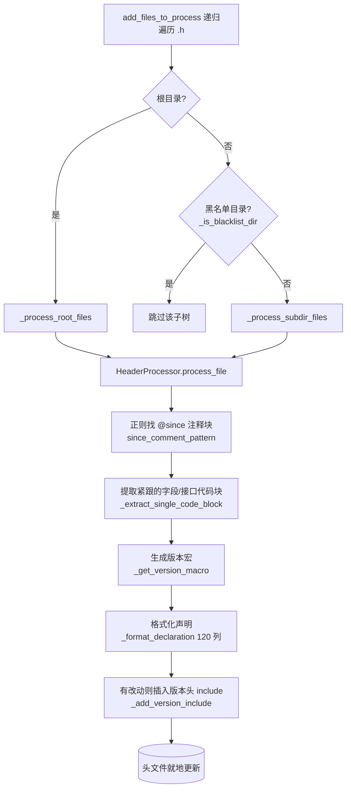

# 03.3 注入 API 版本可用性宏（`HeaderProcessor` / `parse_native_headers.py`）

> 对应 [03-头文件加工](./03-头文件加工-00总览.md) 的 Step 3。
> 触发条件：非 `--skip-version-macro`（lite 构建跳过本步）。
> 脚本：`interface/sdk_c/build-tools/parse_native_headers.py`（546 行），核心类 `HeaderProcessor`。

## 1. 环节职责

| 项 | 内容 |
| -- | ---- |
| 作用 | 为带 `@since` 的声明就地注入 `__attribute__((__availability__(ohos, introduced=...)))`，并在头文件顶部插入版本头 include |
| 输入 | 已拷贝到 `$ndk_headers_out_dir` / `$ndk_lite_headers_out_dir` 的头文件（`_parse_ndk_headers` / `_parse_lite_ndk_headers` 均会走到本步，后者经 `--skip-version-macro` 跳过） |
| 输出 | 头文件就地改写 |
| 目标声明 | `@since` 注释块紧跟的字段（extern 变量）与函数接口声明 |

## 2. 处理流程



## 3. 关键机制

### 3.1 模式识别（HeaderProcessor 初始化，44-86 行）

| 正则 | 行号 | 作用 |
| ---- | ---- | ---- |
| `guard_pattern` | 50 | 头文件保护宏（`#define XXX_H`），用于定位 include 插入点 |
| `since_comment_pattern` | 53-58 | 匹配"带 `@since` 的完整注释块 + 紧跟的代码起始特征" |
| `extern_field_start_pattern` | 61 | 匹配 extern 字段声明 |
| `func_interface_start_pattern` | 63-69 | 匹配函数接口声明（排除 typedef / inline，括号配对确认完整） |
| `since_pattern` | 75-81 | 解析 `@since` 版本，支持 `26` / `26.0.1` / `5.0.3(15)` |
| `deprecated_pattern` | 83 | 解析 `@deprecated since N`（仅数字） |

### 3.2 版本宏生成（`_get_version_macro`，203-232 行）

`@since` 值 → `__attribute__((__availability__(ohos, introduced=<major>.<minor>.<patch>)))`：

| `@since` 格式 | 生成 introduced |
| ------------- | --------------- |
| 纯数字 `26` | `26.0.0` |
| 三段点分式 `26.0.1` | `26.0.1` |
| 三段+括号 `5.0.3(15)` | `15.0.0`（取括号内主版本） |
| 其他格式 | `raise ValueError` |

> `__OH_AVAILABILITY` / `__OH_VERSION` **不是**本脚本生成的宏，而是 [03.2 API 版本校验](./03-头文件加工-02API版本校验.md) 的 `parse_interfaces_since.py` 在 clang 校验时用 `-D` 屏蔽 `__availability__` 属性的占位宏。

### 3.3 声明改写（`_process_since_comment_related_code`，121-153 行）

- 倒序遍历匹配到的注释块，避免前移导致索引错位；
- 用 `_extract_single_code_block`（156-177 行）取注释块后第一个完整字段/接口代码块；
- 替换为 `原注释块 + 格式化后的声明`。

### 3.4 版本头 include（`_add_version_include`，180-200 行）

- 优先在头文件保护宏后插入 `#include "info/application_target_sdk_version.h"`；
- 无保护宏时，在第一个 `#include` 前插入；
- 该版本头由 [02-子系统BUILD](./02-子系统BUILD.md) 的 musl `updated_version` 目标用 `api_version` 生成（含 `APIAVAILABLE` 宏 / `get_application_target_sdk_version` 等）。

### 3.5 格式排版（`_format_declaration`，235-248 行）

拼接 `声明 + 版本宏` 后按 120 列（`MAX_LINE_LENGTH`）决定单行或换行显示，保留原缩进。

## 4. 跳过目录

`HeaderProcessor._DIR_NOT_PROCESS`（parse_native_headers.py:27-41）黑名单，不注入版本宏：

```
aarch64-linux-ohos / arm-linux-ohos / asm-generic / asm-loongarch / asm-mips /
asm-riscv / EGL / GLES2 / GLES3 / i686-linux-ohos / linux / x86_64-linux-ohos / TEEKit
```

这些一般是系统头或三方头文件。lite 构建整步由 `--skip-version-macro` 跳过。

## 5. 相关文件

| 文件 | 作用 |
| ---- | ---- |
| `interface/sdk_c/build-tools/parse_native_headers.py` | 本环节主脚本（`HeaderProcessor`） |
| `interface/sdk_c/third_party/musl/ndk_musl_include/info/application_target_sdk_version.h` | 被 include 的版本头源文件（`APIAVAILABLE` 等宏） |
| `interface/sdk_c/third_party/musl/ndk_script/BUILD.gn` | `updated_version` 生成版本头 → `copy_musl_sysroot` 拷贝 |
| `interface/sdk_c/build-tools/parse_native_headers.pydeps` | Python 依赖清单（生成文件，勿手改） |
