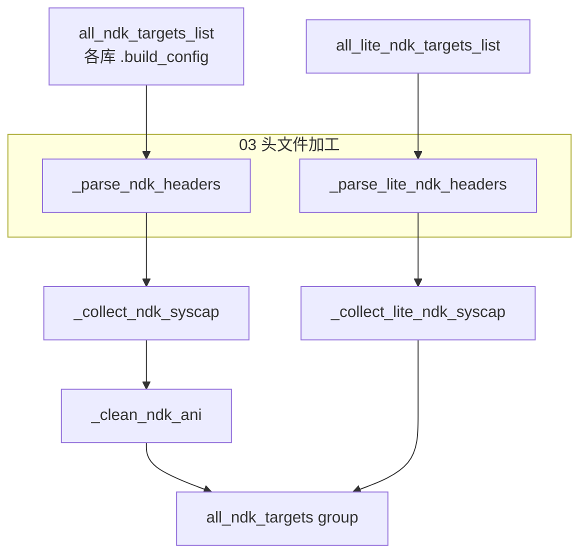

# 04 syscap 收集与 ANI 清理（`_collect_ndk_syscap` / `_clean_ndk_ani`）

> 对应 [00-总览](./00-overview.md)「环节 04」。
> action：`build/ohos/ndk/BUILD.gn:57-80`（`_collect_ndk_syscap`）、115-138（`_collect_lite_ndk_syscap`）、141-154（`_clean_ndk_ani`）。
> 脚本：`build/ohos/ndk/collect_ndk_syscap.py`（80 行）、`interface/sdk_c/build-tools/clean_ndk_ani.py`（143 行）。

## 1. 环节职责

| 项 | 内容 |
| -- | ---- |
| 作用 | ①把各库目标声明的系统能力（syscap）汇总为映射表；②剔除 ANI（ArkUI Native API）专用头文件 |
| 顺序 | 非 lite 链：03 `_parse_ndk_headers` → `_collect_ndk_syscap` → `_clean_ndk_ani`；lite 分支：03 `_parse_lite_ndk_headers` → `_collect_lite_ndk_syscap`（两链并行） |
| 输入 | 各目标的 `<target>.build_config`（syscap 元数据） |
| 输出 | `ndk_system_capability.json`、`nativeapi_syscap_config.json`、`clean_ndk_ani_header.tmp` |

## 2. syscap 收集（`_collect_ndk_syscap`）

### 2.1 数据来源

`ohos_ndk_library` 模板的 `_ndk_config_target` 生成每个库目标的 `<target>.build_config`
（JSON，含 `label` / `lib_name` / `system_capability` / `system_capability_headers`）。

### 2.2 `collect_ndk_syscap.py` 逻辑（collect_ndk_syscap.py:28-55）

```python
for 每个 .build_config:
    lib_name → system_capability        # 写入 ndk_system_capability.json（lib→syscap）
    system_capability → headers 列表    # 写入 nativeapi_syscap_config.json（syscap→headers）
```

| 输出文件 | 内容 |
| -------- | ---- |
| `ndk_system_capability.json` | 库名 → 系统能力映射（`lib` → `syscap`） |
| `nativeapi_syscap_config.json` | 系统能力 → 头文件列表（`syscap` → `headers`） |

> lite 对应分支：`_collect_lite_ndk_syscap`（BUILD.gn:115-138）产出
> `ndk_lite_system_capability.json` / `nativeapi_lite_syscap_config.json`。

## 3. ANI 清理（`_clean_ndk_ani`）

### 3.1 触发条件（BUILD.gn:140-165）

```
if (!defined(ext_ndk_config_file) || ext_ndk_config_file == "") {
  if (!sdk_build_arkts) {
    deps += [ ":_clean_ndk_ani" ]
  }
}
```

即：外部扩展 NDK 配置时跳过；`sdk_build_arkts` 构建时跳过。

### 3.2 `clean_ndk_ani.py` 逻辑（clean_ndk_ani.py:79-138）

| 步骤 | 方法 | 作用 |
| ---- | ---- | ---- |
| 删头文件 | `clean_ndk_ani_headers`（79-98 行） | 删除 `ani.h` / `native_node_ani.h` 本体（`_ANI_HEADER_LISTS` 25-28 行） |
| 删引用 | 同函数 | 从其他所有 `.h` 中移除 `#include ".../ani.h"` / `<.../ani.h>` 行（`_HEADER_PATTERN` 31-35 行） |
| 清理 syscap 映射 | `clean_json_system_capability_headers`（102-124 行） | 从 `nativeapi_syscap_config.json` 剔除映射到 ani 头文件的条目 |

### 3.3 为什么清理 ANI

ANI（ArkUI Native Interface）是 arkui 组件的 native 接口头（`ani.h`、`native_node_ani.h`），
不作为公共 NDK 头文件对外发布（或由独立交付路径提供），故从 sysroot 与 syscap 映射中剔除。

## 4. 流程依赖



> 注：`_parse_ndk_headers`（P1）与 `_parse_lite_ndk_headers`（P2）属于 [03-头文件加工](./03-header-processing-00-overview.md)，二者无相互依赖、ninja 并行执行；
> 本环节的 `_collect_ndk_syscap`（B）与 `_collect_lite_ndk_syscap`（B2）分别承接 P1 / P2，两条链并行，最终汇入 `all_ndk_targets` group，`_clean_ndk_ani`（C）仅挂在非 lite 链后。

## 5. 相关文件

| 文件 | 作用 |
| ---- | ---- |
| `build/ohos/ndk/collect_ndk_syscap.py` | syscap 收集 |
| `interface/sdk_c/build-tools/clean_ndk_ani.py` | ANI 清理 |
| `build/ohos/ndk/BUILD.gn` | `_collect_ndk_syscap` / `_collect_lite_ndk_syscap` / `_clean_ndk_ani` action |
