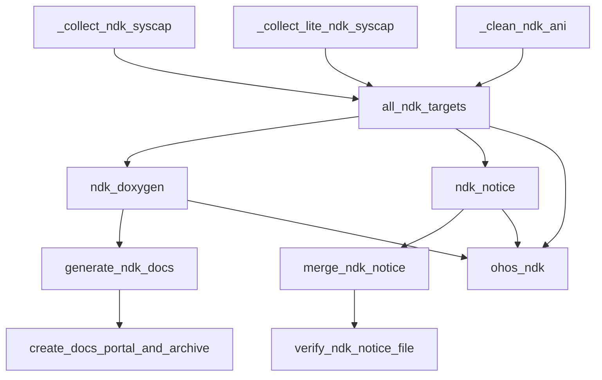

# 05 汇聚、文档生成与 Notice 合规

> 对应 [00-总览](./00-overview.md)「环节 05」。
> 相关目标：`all_ndk_targets` group、`ndk_doxygen` group、`ndk_notice` group
> （`build/ohos/ndk/BUILD.gn:156-176`、`191-362`）。

## 1. 环节职责

| 项 | 内容 |
| -- | ---- |
| 作用 | 把头文件 / 库 / syscap / ANI 相关 action 汇聚为一个 group，并产出文档与 Notice |
| 输入 | 04 环节的产物 |
| 输出 | `docs/html`、`index.html`、`NOTICE.txt` / `NOTICE.gz` |

## 2. group 拓扑（BUILD.gn:156-199）



```
ndk_targets = [ ":ndk_doxygen", ":all_ndk_targets", ":ndk_notice" ]
group("ohos_ndk") { deps = ndk_targets; if (archive_ndk) deps += [ ":archive_ndk" ] }
```

## 3. `all_ndk_targets` group（BUILD.gn:156-166）

```
deps = [ ":_collect_ndk_syscap" ]
if (all_lite_ndk_targets_list != []) { deps += [ ":_collect_lite_ndk_syscap" ] }
if (未指定 ext_ndk_config_file && !sdk_build_arkts) { deps += [ ":_clean_ndk_ani" ] }
```

汇聚点为 `_collect_ndk_syscap` / `_collect_lite_ndk_syscap`（其上游 03 的 `_parse_ndk_headers` / `_parse_lite_ndk_headers` 又依赖各自的全部头文件/库目标）。

## 4. 文档生成（`ndk_doxygen`，BUILD.gn:191-253）

| 子目标 | 脚本 | 输出 |
| ------ | ---- | ---- |
| `generate_ndk_docs` | `build/ohos/ndk/generate_ndk_docs.py`（doxygen） | `sdk-native/os-irrelevant/docs/html` |
| `create_docs_portal_and_archive` | `create_ndk_docs_portal.py` | `docs/index.html`（meta refresh 跳转到 `html/index.html`） |

`generate_ndk_docs`：
- 在 `$ndk_headers_out_dir` 上跑 doxygen，`Doxyfile` 的 `%VERSION%` / `%OUTPUT_DIR%` 被替换；
- 无 doxygen 时跳过（不阻断）；
- `ndk_docs_portal`（`docs/index.html`）作为产物。

开关：`enable_ndk_doxygen`（`ndk.gni:25`，默认 `true`）。

## 5. Notice 合规（`ndk_notice`，BUILD.gn:168-176、321-362）

| 子目标 | 脚本 | 输出 |
| ------ | ---- | ---- |
| `merge_ndk_notice` | `build/ohos/notice/merge_notice_files.py` | `ndk_notice_txt`（`NOTICE.txt`）、`ndk_notice_gz` |
| `verify_ndk_notice_file` | `build/core/build_scripts/verify_notice.sh` | 校验结果 `.out` |

- `merge_ndk_notice` 的 `--image-name ndk`，Notice 标题为
  "Notices for files and software contained in sdk-native in this directory:"；
- 各库 / 拷贝目标通过 `collect_notice` 写入 `$ndk_notice_dir`，最终合并为 `NOTICE.txt`；
- 该 `NOTICE.txt` 会被 [06-打包归档](./06-packaging-and-archive.md) 追加进 native zip。

开关：`enable_process_notice`。

## 6. 相关文件

| 文件 | 作用 |
| ---- | ---- |
| `build/ohos/ndk/BUILD.gn` | group 拓扑与 action 定义 |
| `build/ohos/ndk/generate_ndk_docs.py` | doxygen 文档生成 |
| `build/ohos/ndk/create_ndk_docs_portal.py` | 文档门户页 |
| `build/ohos/notice/merge_notice_files.py` | Notice 合并 |
| `build/core/build_scripts/verify_notice.sh` | Notice 校验 |
