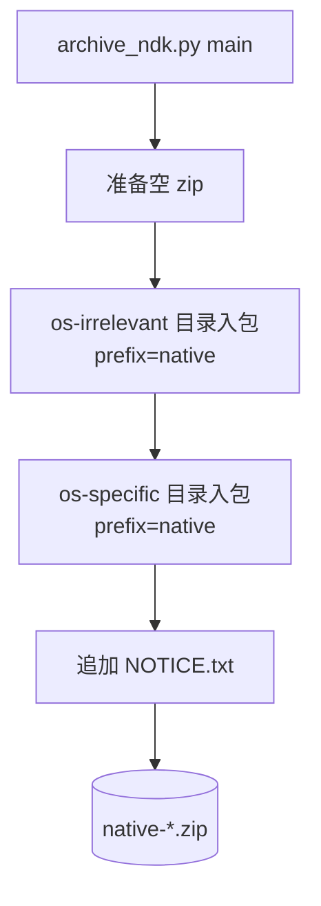

# 06 打包归档（`archive_*_ndk` / `archive_ndk.py`）

> 对应 [00-总览](./00-总览.md)「环节 06」。
> action：`build/ohos/ndk/BUILD.gn:396-556`（5 个平台的 `archive_*_ndk`）。
> 脚本：`build/ohos/ndk/archive_ndk.py`（121 行）。

## 1. 环节职责

| 项 | 内容 |
| -- | ---- |
| 作用 | 把 `os-irrelevant` + `os-specific` 两个目录打成平台对应的 native zip，并追加 NOTICE |
| 输入 | `ndk_os_irrelevant_out_dir`、`ndk_<os>_specific_out_dir`、`ndk_notice_txt` |
| 输出 | `out/<产品>/packages/<产品名>/<os>/native-<os>-<arch>-<version>.zip` |
| 依赖 | `deps = ndk_targets`（含 all_ndk_targets + doxygen + notice） |

## 2. 平台与命名（BUILD.gn:396-556）

| action | 平台 | 输出 zip 名 |
| ------ | ---- | ----------- |
| `archive_windows_ndk` | windows | `native-windows-x64-<version>.zip` |
| `archive_linux_ndk` | linux | `native-linux-x64-<version>.zip` |
| `archive_darwin_ndk` | darwin | `native-darwin-x64-<version>.zip` |
| `archive_ohos_ndk` | ohos | `native-ohos-<target_arch>-<version>.zip` |
| `archive_linux_arm64_ndk` | linux-arm64 | `native-linux-arm64-<arch>-<version>.zip` |

> 若 `release_type != ""`，文件名追加 `-<release_type>`。
> 落盘目录 `ohos_sdk_out_dir = out/<产品>/packages/<产品名>/<os>`，与 TS SDK zip 同目录。

## 3. 处理流程（`archive_ndk.py`）



关键函数（archive_ndk.py）：

| 函数 | 行号 | 作用 |
| ---- | ---- | ---- |
| `archive_ndk` | 64-81 | 依次把 os-irrelevant、os-specific 入包，再追加 Notice |
| `do_archive` | 45-61 | 遍历目录，按 `prefix` 决定 zip 内路径（统一挂 `native/` 前缀） |
| `file_filter` | 84-92 | windows 专用：过滤 `sysroot/usr/include/linux` 下与同名小写文件重复的大写头（避免大小写不敏感文件系统冲突） |
| `main` | 95-117 | 参数解析 + depfile 记录（`call_and_write_depfile_if_stale`） |

## 4. zip 内目录结构

顶层目录为 `native/`（`prefix = ndk_zip_prefix = "native"`）：

```
native/
|-- build/                # cmake 配置文件（ohos.toolchain.cmake 等）
|-- build-tools/          # cmake / ninja 等工具
|-- docs/                 # sysroot 文档（doxygen）
|-- llvm/                 # 各 OS 交叉工具链
|-- sysroot/              # 头文件 + 库
|-- sysroot_lite/         # lite 头文件 + 库
|-- nativeapi_syscap_config.json
|-- NOTICE.txt
|-- oh-uni-package.json
```

## 5. `archive_ndk` group（BUILD.gn:364-394）

按 `ndk_platform` / `build_*_ndk_target` 开关收集需要产出的平台：

| 条件 | 产出 |
| ---- | ---- |
| `ndk_platform == "default"` | 按 `host_os`：mac→darwin；linux/arm64→linux-arm64；其余→linux + ohos + windows |
| `build_windows_ndk_target` | windows |
| `build_mac_ndk_target` | darwin |
| `build_linux_ndk_target` | linux |
| `build_linux_arm64_ndk_target` | linux-arm64 |
| `build_ohos_ndk_target` | ohos |

## 6. 相关文件

| 文件 | 作用 |
| ---- | ---- |
| `build/ohos/ndk/archive_ndk.py` | 打 zip 主脚本 |
| `build/ohos/ndk/BUILD.gn` | 5 个 `archive_*_ndk` action + `archive_ndk` group |
| `build/ohos/ndk/ndk.gni` | `ndk_os_irrelevant_out_dir` / `ndk_<os>_specific_out_dir` / `ndk_zip_prefix` |
| `build/ohos/sdk/sdk.gni` | `ohos_sdk_out_dir`（最终落盘目录） |
