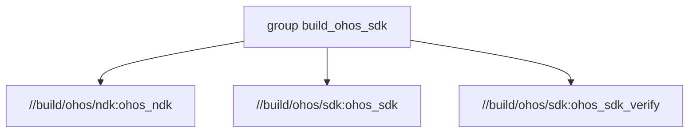

# 07 SDK 聚合与完整性校验（NDK + TS SDK）

> 对应 [00-总览](./00-overview.md)「环节 07」。
> 聚合入口：`build/core/gn/BUILD.gn` 的 `build_ohos_sdk` group。
> 完整性校验：`build/ohos/sdk/BUILD.gn` 的 `check_sdk_completeness`。

## 1. 环节职责

| 项 | 内容 |
| -- | ---- |
| 作用 | 把 NDK（native）+ TS SDK（ets/js/previewer/toolchains）聚合为完整 SDK 交付 |
| 入口 | `./build.sh --product-name ohos-sdk` → `build_ohos_sdk` group |
| 产物 | `out/<产品>/packages/<产品名>/<os>/` 下各 zip 齐全 |

## 2. 聚合拓扑（build/core/gn/BUILD.gn:23-30）

即 SDK 构建 = NDK + TS SDK + 完整性校验，**并行产出、同仓聚合**。

## 3. NDK 与 TS SDK 的关系

| 项 | NDK（sdk_c） | TS SDK（sdk-js） |
| -- | ------------ | ---------------- |
| 语言侧 | C / Native | ArkTS / TS |
| zip 前缀 | `native-<os>-<arch>-<ver>.zip` | `ets-*` / `js-*` / `previewer-*` / `toolchains-*` |
| 落盘目录 | `out/<产品>/packages/<产品名>/<os>/` | 同目录 |
| 数据依赖 | 无（不消费 TS SDK 产物） | 无（不消费 NDK 产物） |
| 聚合点 | `check_sdk_completeness` 校验时要求 native/ 目录齐全 | 同 |

## 4. 完整性校验（`check_sdk_completeness`，build/ohos/sdk/BUILD.gn:222-251）

- `sdk_delivery_list.json` 中每个 OS 平台要求六类交付目录：`ets/`、`js/`、`native/`、
  `previewer/`、`toolchains/`、`cangjie/`；
- `deps` 含 `//build/ohos/ndk:ohos_ndk`（225 行），确保 NDK 先产出再校验；
- `check_sdk_completeness.py` 按清单逐目录检查，缺则报错。

## 5. 签名与 Notice（build/ohos/sdk/BUILD.gn:253-304）

| 目标 | 说明 |
| ---- | ---- |
| `sign_mac_sdk`（278-289） | macOS SDK 签名，依赖 `ohos_ndk` |
| `sign_ohos_sdk`（291-304） | ohos SDK 签名，依赖 `ohos_ndk` |
| `add_notice_file`（253-276） | `--skip-pattern "native"`：native zip 的 Notice 由 NDK 自产（`merge_ndk_notice` 已打包），SDK 层跳过不重复添加 |

## 6. 路径速查

| 路径 | GN 变量 | 说明 |
| ---- | ------- | ---- |
| `out/<产品>/sdk-native` | `ndk_os_irrelevant_out_dir` 的父级 | NDK 加工产物 |
| `out/<产品>/packages/<产品名>/<os>/native-*.zip` | `ohos_sdk_out_dir` | NDK 最终 zip |
| `out/<产品>/packages/<产品名>/<os>/ets-*.zip` | 同（TS SDK 侧） | TS SDK zip |
| `build/ohos/sdk/sdk_delivery_list.json` | — | 交付清单（含 native） |

## 7. 相关文件

| 文件 | 作用 |
| ---- | ---- |
| `build/core/gn/BUILD.gn` | `build_ohos_sdk` 聚合入口 |
| `build/ohos/sdk/BUILD.gn` | `check_sdk_completeness` / `sign_*` / `add_notice_file` |
| `build/ohos/sdk/sdk_delivery_list.json` | 交付清单 |
| `build/ohos/sdk/sdk.gni` | `ohos_sdk_out_dir` |
| `build/ohos/build_var.gni` | `product_output_dir` |
