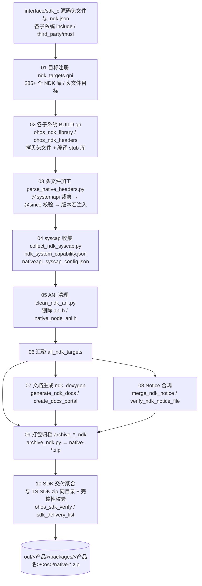

# 00 全链路总览（SDK Native / NDK）

> 本文档记录 **OpenHarmony C API（`interface/sdk_c`）** 从源码头文件到 Native SDK 产物
> （`native-<os>-<arch>-<version>.zip`）的完整编译构建处理流程，按 GN/ninja 执行顺序自上而下。
> 构建入口：`./build.sh --product-name ohos-sdk`。

## 1. 全链路流程图

> 注：**03 的 `_parse_ndk_headers` 与 `_parse_lite_ndk_headers` 是两个独立 action、并行执行**（无相互依赖，ninja 按各自 deps 调度）。
> 二者调用同一个 `parse_native_headers.py`，仅 lite 分支追加 `--skip-version-macro`；
> 后续分别由 04 的 `_collect_ndk_syscap` / `_collect_lite_ndk_syscap` 承接，见 [03](./03-头文件加工-00总览.md) 1.1 与 [04](./04-syscap与ANI清理.md) 4。

> 与 [sdk-js 全链路汇总](../../../sdk-js/docs/build/05-全链路汇总/00-总览.md) 的分工：
> **NDK（sdk_c）是 C 侧**，产出 `native` 包（头文件 + stub 库 + 工具链 + sysroot）；
> **TS SDK（sdk-js）是 ArkTS 侧**，产出 `ets` / `js` / `previewer` 包。
> 两者由 `build/core/gn/BUILD.gn` 的 `build_ohos_sdk` 一并拉起，最终同目录落盘。

## 2. 环节速览

| 文件                          | 环节（GN 顺序）         | 核心脚本 / 模板                                                                                                   | 输入 → 输出                                                          |
| ----------------------------- | ----------------------- | ---------------------------------------------------------------------------------------------------------------- | ------------------------------------------------------------------- |
| [01](./01-目标注册表.md)        | 目标注册 `ndk_targets.gni` | `interface/sdk_c/ndk_targets.gni`                                                                             | 285+ 目标 → `all_ndk_targets_list` / `all_lite_ndk_targets_list` |
| [02](./02-子系统BUILD.md)       | 各子系统 `BUILD.gn`     | `build/ohos/ndk/ndk.gni` 模板：`ohos_ndk_library` / `ohos_ndk_headers` / `ohos_ndk_copy` / `ohos_ndk_prebuilt_library`预留 / `ohos_ndk_lite_library` | `.ndk.json` + 头文件 → `out/<产品>/sdk-native/os-irrelevant/sysroot/usr/{include,lib}` |
| [03](./03-头文件加工-00总览.md)  | 头文件加工 `_parse_ndk_headers` / `_parse_lite_ndk_headers` | `interface/sdk_c/build-tools/parse_native_headers.py` → `header_processor.py`、`parse_interfaces_since.py`      | `sysroot/usr/include` / `sysroot_lite` → 就地修改（裁剪 / 校验 / 加宏）              |
| [04](./04-syscap与ANI清理.md)  | syscap 收集 + ANI 清理  | `build/ohos/ndk/collect_ndk_syscap.py`、`interface/sdk_c/build-tools/clean_ndk_ani.py`                            | `.build_config` → `ndk_system_capability.json`、`nativeapi_syscap_config.json`、`clean_ndk_ani_header.tmp` |
| [05](./05-汇聚与检查.md)        | 汇聚 + 文档 + Notice   | `all_ndk_targets` group、`generate_ndk_docs.py`、`create_ndk_docs_portal.py`、`merge_notice_files.py`、`verify_notice.sh` | `all_ndk_targets` → docs / NOTICE.txt                                  |
| [06](./06-打包归档.md)          | 打包归档 `archive_*_ndk` | `build/ohos/ndk/archive_ndk.py`                                                                               | `sdk-native/os-irrelevant` + `os-specific` → `out/<产品>/packages/<产品名>/<os>/native-*.zip` |
| [07](./07-SDK聚合.md)           | SDK 聚合与完整性校验    | `build/core/gn/BUILD.gn`、`build/ohos/sdk/BUILD.gn`（`check_sdk_completeness`）、`sdk_delivery_list.json` | `native-*.zip` + `ets/js/previewer/toolchains` → 完整 SDK             |

## 3. 脚本 / 模板总览（按执行顺序）

### 01 目标注册（GN 生成期）

| 文件 | 作用 |
| ---- | ---- |
| `interface/sdk_c/ndk_targets.gni` | 列出全部 NDK 库 / 头文件目标；被 `build/ohos/ndk/BUILD.gn:26` import |

### 02 子系统 BUILD.gn（ninja 期）

| #    | 模板 | 作用 | 产物 |
| ---- | ---- | ---- | ---- |
| 02.1 | `ohos_ndk_library` | 由 `.ndk.json` 生成 stub C → 编译 `shared_library` → 拷贝到 sysroot/usr/lib | `lib<name>.{z.so,so}`、`.map.txt`、`.build_config` |
| 02.2 | `ohos_ndk_headers` | 签名检查 + clang 编译检查 + 拷贝头文件 | `sysroot/usr/include/<模块>/**` |
| 02.3 | `ohos_ndk_copy` / `ohos_ndk_prebuilt_library`预留 / `ohos_ndk_toolchains` | 纯拷贝（cmake / 预置库 / 工具链） | `sdk-native/{os-irrelevant,os-specific}` 下对应目录 |
| 02.4 | `ohos_ndk_lite_library` | lite（cortex-m / riscv32）库模板 | `sysroot_lite/usr/lib/{riscv32-linux-ohos,arm-liteos-ohos}` |

### 03 头文件加工（action `_parse_ndk_headers` / `_parse_lite_ndk_headers`）

| #    | 脚本 | 触发条件 | 处理内容 |
| ---- | ---- | -------- | -------- |
| 03.1 | `parse_native_headers.py` 调 `header_processor.py` | `sdk_build_public == "true"` | 删除带 `@systemapi` 的 API 声明 |
| 03.2 | `parse_native_headers.py` 调 `parse_interfaces_since.py` | `sdk_build_check_level != "0"` | 校验 `@since` 版本不高于构建 API 版本 |
| 03.3 | `parse_native_headers.py` 的 `HeaderProcessor` | 非 `--skip-version-macro`（lite 跳过） | 为带 `@since` 的声明注入 `__attribute__((availability))` 宏 + include 版本头 |

> `_parse_ndk_headers` 与 `_parse_lite_ndk_headers` 并行调用同一脚本，lite 分支额外传 `--skip-version-macro`（见 [03](./03-头文件加工-00总览.md) 1.1）。

### 04 syscap 收集 + ANI 清理

| #    | action | 脚本 | 输出 |
| ---- | ------ | ---- | ---- |
| 04.1 | `_collect_ndk_syscap` | `build/ohos/ndk/collect_ndk_syscap.py` | `ndk_system_capability.json`、`nativeapi_syscap_config.json` |
| 04.2 | `_collect_lite_ndk_syscap` | 同 `collect_ndk_syscap.py`（lite 分支） | `ndk_lite_system_capability.json`、`nativeapi_lite_syscap_config.json` |
| 04.3 | `_clean_ndk_ani` | `interface/sdk_c/build-tools/clean_ndk_ani.py` | 剔除 `ani.h` / `native_node_ani.h` 及 `#include` 引用 |

### 05 汇聚 + 文档 + Notice

| #    | group / action | 脚本 | 输出 |
| ---- | -------------- | ---- | ---- |
| 05.1 | `all_ndk_targets` | — | 依赖 `_collect_ndk_syscap` + lite + `_clean_ndk_ani` |
| 05.2 | `generate_ndk_docs` | `build/ohos/ndk/generate_ndk_docs.py`（doxygen） | `sdk-native/os-irrelevant/docs/html` |
| 05.3 | `create_docs_portal_and_archive` | `create_ndk_docs_portal.py` | `docs/index.html` |
| 05.4 | `merge_ndk_notice` / `verify_ndk_notice_file` | `merge_notice_files.py` / `verify_notice.sh` | `NOTICE.txt` / `NOTICE.gz` |

### 06 打包归档（`archive_*_ndk` ×5 平台）

| 平台 | action | 输出 |
| ---- | ------ | ---- |
| linux | `archive_linux_ndk` | `native-linux-x64-<version>.zip` |
| windows | `archive_windows_ndk` | `native-windows-x64-<version>.zip` |
| darwin | `archive_darwin_ndk` | `native-darwin-x64-<version>.zip` |
| ohos | `archive_ohos_ndk` | `native-ohos-<target_arch>-<version>.zip` |
| linux-arm64 | `archive_linux_arm64_ndk` | `native-linux-arm64-<arch>-<version>.zip` |

### 07 SDK 聚合

| 项 | 脚本 / 文件 | 说明 |
| -- | ----------- | ---- |
| 入口聚合 | `build/core/gn/BUILD.gn` 的 `build_ohos_sdk` | `deps = ohos_ndk + ohos_sdk + ohos_sdk_verify` |
| 完整性校验 | `build/ohos/sdk/check_sdk_completeness.py` + `sdk_delivery_list.json` | 每个 OS 要求 `native/` 等交付目录齐全 |
| 与 TS SDK 同目录 | `build/ohos/sdk/BUILD.gn`（`sign_*` / `add_notice_file`） | native zip 由 NDK 自产 Notice，SDK 层 `--skip-pattern native` 跳过 |

## 4. 路径速查

| 路径                                                        | GN 变量                     | 说明                              |
| ----------------------------------------------------------- | --------------------------- | --------------------------------- |
| `out/<产品>/sdk-native/os-irrelevant`                       | `ndk_os_irrelevant_out_dir` | 与主机无关：头文件 / 库 / docs / cmake 配置 |
| `out/<产品>/sdk-native/os-irrelevant/sysroot/usr/include`   | `ndk_headers_out_dir`       | 全部 NDK 头文件                    |
| `out/<产品>/sdk-native/os-irrelevant/sysroot/usr/lib`       | `ndk_libraries_out_dir`     | NDK stub 库（arm/aarch64/x86_64）  |
| `out/<产品>/sdk-native/os-irrelevant/sysroot_lite`          | `ndk_lite_*_out_dir`        | lite 头文件 / 库                   |
| `out/<产品>/sdk-native/os-irrelevant/docs`                  | `ndk_docs_out_dir`          | doxygen 文档                       |
| `out/<产品>/sdk-native/os-specific/<os>/llvm`               | `ndk_<os>_toolchains_out_dir` | 各平台 LLVM 交叉工具链              |
| `out/<产品>/sdk-native/os-specific/<os>/build-tools`        | `ndk_<os>_tools_out_dir`    | cmake 二进制、ninja                |
| `out/<产品>/packages/<产品名>/<os>/native-*.zip`            | `ohos_sdk_out_dir`          | 最终 NDK zip 落盘（与 TS SDK 同目录） |

## 5. 加功能定位速查

| 想加的功能                         | 改动位置            | 具体落点                                                            |
| ---------------------------------- | ------------------- | ------------------------------------------------------------------- |
| 新增 NDK 库（`.so` stub）           | 子系统 BUILD.gn     | 加 `ohos_ndk_library` 实例 + 对应 `libxxx.ndk.json`，并在 `ndk_targets.gni` 登记 |
| 新增 NDK 头文件                     | 子系统 BUILD.gn     | 加 `ohos_ndk_headers` 实例，`ndk_targets.gni` 登记 `:xxx_header`    |
| 头文件裁剪规则（`@systemapi`）      | `header_processor.py` | `SystemApiRemover` / `_process_header_with_clang` / `regex_remove_systemapi` |
| API 版本校验级别                    | 构建参数            | `sdk_build_check_level`（非 0 触发 `parse_interfaces_since.py`）     |
| 打包 zip 的目录过滤                 | `build/ohos/ndk/archive_ndk.py` | `file_filter`（windows 大写头文件去重）                              |
| Notice 合规                         | `merge_notice_files.py` | `--image-name ndk`；`archive_ndk.py` 追加 `NOTICE.txt`               |
